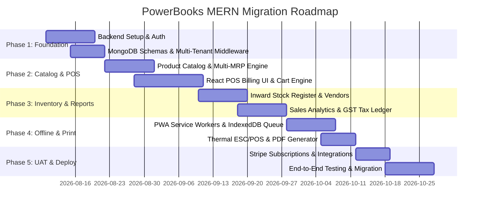

# PowerBooks V2: Legacy Analysis & Modern MERN Stack Re-architecture BRD

## Executive Summary
This document serves as the comprehensive **Business Requirements Document (BRD)** and Technical Specification for re-architecting **PowerBooks V2** from a monolithic **PHP / CodeIgniter 3** application into a modern, production-grade **MERN Stack (MongoDB, Express.js, React, Node.js)** platform.

PowerBooks V2 is an all-in-one Cloud Point of Sale (POS), Retail ERP, Inventory Management, CRM, Tax Ledger, and Financial Reporting SaaS designed for Small and Medium Enterprises (SMEs) and retail merchants.

---

## 1. Problem Statement & Need for Migration

### 1.1 Legacy Architecture Limitations (CodeIgniter 3)
* **Monolithic Controller Codebase**: `Dashboard.php` exceeds 2,600 lines with mixed HTML generation, SQL logic, and view rendering inside controller actions (`IWS_reporter`, `BWS_reporter`, `temp_bill_inward`).
* **Security & Auth Vulnerabilities**: Passwords are hashed using deprecated `md5()`. Direct GET/POST query execution lacks JWT tokens or modern stateless authorization headers.
* **No Offline POS Capability**: Billing completely fails if internet connectivity drops because cart management relies on real-time server database writes (`temp_bill` table).
* **Synchronous Server Side Rendering (SSR)**: Full or partial page reloads slow down cashier throughput at checkout counters.
* **Database Tight Coupling**: Relational MySQL schema requires heavy string joins and `LIKE` pattern queries for monthly/yearly aggregation (`daywise_sales`, `itemwise_sales`).
* **Scalability Bottleneck**: Monolithic architecture prevents independent scaling of the POS billing engine from background analytics reporting.

### 1.2 The MERN Solution Vision
Rebuilding PowerBooks on the MERN stack with **Progressive Web App (PWA)** capabilities ensures instant barcode scanning, zero-latency checkout, offline billing with background sync, robust JWT-based role-based access control (RBAC), modular RESTful APIs, and real-time websockets for store management.

---

## 2. Project Overview & Scope

* **Product Name**: PowerBooks Cloud ERP & POS (v3.0 - MERN Edition)
* **Target Industry**: Retail Supermarkets, Apparel Stores, Electronics Outlets, Restaurants, Quick-Service Businesses, and Wholesalers.
* **Core Value Proposition**: Rapid cashier billing, multi-MRP pricing support, real-time inventory tracking, customer CRM insight, automated GST tax reports, and multi-device cloud accessibility.

---

## 3. Business Goals

1. **Increase Cashier Checkout Velocity**: Reduce billing cycle time per customer from ~30 seconds to <5 seconds using instant React state updates and keyboard shortcuts.
2. **Ensure 99.99% POS Availability**: Implement local IndexedDB offline storage so sales continue seamlessly during internet outages.
3. **Enhance Security & Compliance**: Migrate to bcrypt password hashing, JWT stateless authentication, sanitized data layers, and secure Stripe webhook verification.
4. **SaaS Multi-Tenancy Expansion**: Seamlessly onboard thousands of merchants (`merchant_id` tenant isolation) with automated subscription billing and tier-based feature access.
5. **Real-time Business Intelligence**: Provide instant visual analytics for daily gross/net sales, top 10 bestselling items, profit margins, and month-on-month growth.

---

## 4. User Personas

| Persona Name | Role | Primary Goals & Responsibilities | Pain Points in Legacy System |
| :--- | :--- | :--- | :--- |
| **Super Admin** | Platform Owner | System maintenance, managing global options (`options_master`), merchant onboarding, platform pricing. | Lack of tenant usage metrics and subscription telemetry. |
| **Merchant Admin (Owner)** | Business Owner | Store setup, adding inventory, setting multi-MRP rates, staff management, reviewing day-end sales, tax filing. | Slow reporting queries, manual day-end trigger emails, lack of real-time multi-store monitoring. |
| **Store Manager** | Supervisor | Inward stock registration (`goods_inward`), approving void bills, vendor management, staff scheduling. | Manual line-item entry, static table views, no batch barcode scanning support. |
| **Billing Cashier (Staff)** | Front-line Operator | Scanning barcodes, adding items to cart, collecting cash/card/UPI, printing thermal receipts. | UI latency, loss of current cart on network glitch, clunky popup modals for payment entry. |
| **End Customer** | Shopper | Quick checkout, transparent digital invoice via SMS/WhatsApp/Email, membership points tracking. | Long queue wait times, paper-only receipts. |

---

## 5. System Architecture & Tech Stack Comparison

### 5.1 Tech Stack Mapping

| Layer | Legacy CodeIgniter Stack | Proposed MERN Stack |
| :--- | :--- | :--- |
| **Frontend Framework** | AdminBSB HTML5 Templates, jQuery, Vanilla CSS | **React 18** (TypeScript, Vite, TailwindCSS, Lucide Icons, Shadcn UI) |
| **Backend Runtime** | PHP 7.x / CodeIgniter 3 MVC Framework | **Node.js + Express.js** (TypeScript, Controllers/Services/Routes pattern) |
| **Database** | MySQL 5.7 / MariaDB (ActiveRecord / Raw SQL) | **MongoDB 7.0** (Mongoose ODM, Document schema with indexed tenant IDs) |
| **Authentication** | PHP Session Cookies (`pbk_sess`), MD5 passwords | **Stateless JWT** (AccessToken + RefreshToken in HttpOnly Cookies), Bcrypt hashing |
| **PDF & Receipts** | DOMPDF (PHP) | **Puppeteer / React-PDF** + Direct Thermal ESC/POS WebUSB/WebBluetooth printing |
| **Payment Gateway** | Stripe PHP SDK | **Stripe Node.js SDK** + Webhooks + UPI / Razorpay Integration |
| **Offline Engine** | None (Internet required) | **Workbox PWA Service Workers + IndexedDB** (RxDB / Dexie.js offline queue) |

### 5.2 Architecture Diagram

```mermaid
graph TD
    subgraph Client Layer (React 18 SPA / PWA)
        UI[React UI Dashboard & POS Interface]
        State[Zustand / Redux Toolkit State]
        IDB[(IndexedDB Local Store)]
        SW[Service Worker Offline Queue]
        UI --> State
        State <--> IDB
        State <--> SW
    end

    subgraph API Gateway / Backend (Node.js & Express)
        AuthGuard[JWT Auth & RBAC Middleware]
        TenantGuard[Multi-Tenant Context Injector]
        POSService[POS & Cart Processing Module]
        InvService[Inventory & Inward Stock Module]
        AnalyticsService[Sales Aggregation & Reporting Engine]
        PDFService[Thermal Receipt & PDF Generator]
        
        AuthGuard --> TenantGuard
        TenantGuard --> POSService
        TenantGuard --> InvService
        TenantGuard --> AnalyticsService
        TenantGuard --> PDFService
    end

    subgraph Data & Storage Layer
        Mongo[(MongoDB Atlas Cluster)]
        Redis[(Redis Cache - Sessions & Rate Limits)]
    end

    subgraph External Integrations
        Stripe[Stripe / Payment Gateways]
        Mail[SendGrid / Nodemailer Email]
        SMS[WhatsApp / Twilio SMS API]
    end

    SW <--> AuthGuard
    State <--> AuthGuard
    POSService --> Mongo
    InvService --> Mongo
    AnalyticsService --> Mongo
    POSService <--> Redis
    POSService --> Stripe
    AnalyticsService --> Mail
    POSService --> SMS
```

---

## 6. Functional Requirements

### 6.1 Authentication & Onboarding Module
* **FR-1.1**: User registration with email verification OTP timer.
* **FR-1.2**: Multi-step Merchant Onboarding: Company details, Brand name, GSTIN, PAN, Business Category (Retail, Supermarket, Restaurant), Store Address, Thermal Printer layout settings.
* **FR-1.3**: Role-Based Authorization: Roles include `SUPER_ADMIN`, `ADMIN`, `MANAGER`, `STAFF`.
* **FR-1.4**: Configurable Billing Flags: Enable/Disable stock control (`manage_stocks`), Direct Billing redirect, Staging Invoices, Auto Day-End, and Due Date Billing.

### 6.2 Product Catalog & Multi-MRP Pricing Module
* **FR-2.1**: Product Creation (`item_master`): Barcode (TZ Barcode), SKU, Item Name, Item Description, Division, Category, Classification.
* **FR-2.2**: Multi-MRP Matrix (`multiple_price`): Allow single barcode to have multiple selling rates based on Cost Price, MRP, Retail Price, and GST Tax Slab (0%, 5%, 12%, 18%, 28%).
* **FR-2.3**: Category & Division Hierarchy: Master classification for quick filtering in POS grid.

### 6.3 POS Billing Engine & Cart Management Module
* **FR-3.1**: Rapid Barcode Scanning: Instant item lookup via hardware barcode scanner or manual search.
* **FR-3.2**: Multi-Price Selection Modal: Prompt cashier if barcode has multiple active retail prices.
* **FR-3.3**: Live Cart Summary (`temp_bill`): Dynamic calculation of Item Qty, Gross Amount, GST Tax Amount per slab, Promo Discounts, and Net Payable (rounded).
* **FR-3.4**: Payment Modes: Cash (with Cash Tendered & Change Balance math), Card, UPI/QR Code, Split Payment, and Store Due Billing.
* **FR-3.5**: Void Bill Management: Authorized managers can void completed transactions with mandatory reason logging.

### 6.4 Inventory & Goods Inward Register Module
* **FR-4.1**: Vendor/Supplier Master: Vendor ID, Vendor Type, Company Name, Contact Info.
* **FR-4.2**: Goods Inward Register (`goods_inward`): Inward stock entry modal staging (`temp_inward_master`) before posting to live inventory.
* **FR-4.3**: Automated Stock Balance Ledger: Auto-increment `stock_balance` on goods inward posting; auto-decrement on POS sales checkout.

### 6.5 Customer CRM & Relationship Insights Module
* **FR-5.1**: Customer Base Registry: Mobile number, Name, Email, Address, Lead Source.
* **FR-5.2**: CRM Analytics Dashboard: Total customer bills, lifetime spend, average basket size, most purchased items breakdown.
* **FR-5.3**: Walk-in Footfall Counter: Log daily customer walk-ins for conversion tracking.

### 6.6 Day Open / Close & EOD Financial Reporting Module
* **FR-6.1**: Day Open Initialization: Lock system transactions to active POS Date.
* **FR-6.2**: Day Close Automated Aggregation: Summarize Gross Sales, Returns, Net Sales, Cash Collections, Card Collections, Other Payments into `daywise_sales`.
* **FR-6.3**: EOD Sales Report Email: Auto-dispatch styled daily summary email to Merchant Admin upon Day Close.
* **FR-6.4**: Day Re-open: Admin capability to re-open closed date for audit corrections.

### 6.7 Sales Analytics & Tax Ledger Module
* **FR-7.1**: Item-Wise Sales (IWS) Report: Exportable filtered reports by date range.
* **FR-7.2**: Bill-Wise Sales (BWS) Report: Line-by-line invoice status view with void toggle controls.
* **FR-7.3**: Day-Wise Sales (DWS) Report: Daily trend analytics.
* **FR-7.4**: GST Tax Register (`tax_register`): Automated tax breakdown grouped by bill number and tax slab (0%, 5%, 12%, 18%, 28%) for GST return filing (GSTR-1 / GSTR-3B).

### 6.8 SaaS Subscription & Stripe Billing Module
* **FR-8.1**: Subscription Plan Display: PowerBooks renewal plans.
* **FR-8.2**: Stripe Checkout Integration: Secure payment session creation and Stripe webhook processing for account extension.

---

## 7. Non-Functional Requirements (NFR)

* **Performance**: POS Barcode scanning to cart addition response time < 50ms. Page initial load (FCP) < 1.2s.
* **Scalability**: Support up to 10,000 concurrent merchant terminals with horizontal Node.js scaling.
* **Reliability & Availability**: 99.99% uptime with offline PWA cart fallback ensuring zero lost sales during store internet disruption.
* **Data Security**: TLS 1.3 in transit, AES-256 for sensitive data at rest, Bcrypt password hashing (salt round 12), CORS restriction.
* **Usability & Accessibility**: Dark/Light mode theme support, touch-friendly UI for tablet POS terminals, full keyboard shortcut support (e.g. `F2` for Checkout, `F4` for Customer Search, `ESC` for Clear Cart).
* **Maintainability**: Clean TypeScript architecture with modular service layers, ESLint validation, automated CI/CD unit testing.

---

## 8. Database Design (MERN Stack MongoDB Collections)

### 8.1 Data Model Mapping (Relational SQL -> MongoDB Collections)

```
SQL Tables (CodeIgniter)           MongoDB Collections (MERN)
-------------------------          ---------------------------
user_details                -->    users (User Schema)
config_master               -->    merchants (Merchant Schema)
item_master + multiple_price-->    products (Product Schema with embedded price Slabs)
stock_balance               -->    inventory (Stock Ledger Schema)
vendor_supplier_master      -->    vendors (Vendor Schema)
goods_register + purchased  -->    inward_registers (Inward Purchase Schema)
customer_base               -->    customers (Customer Schema)
temp_bill                   -->    carts (Active POS Session Cart Schema)
billwise_sales + itemwise   -->    orders (Order Schema with line-items array)
daywise_sales               -->    daily_summaries (Day Closure Schema)
tax_register                -->    tax_ledgers (Tax Ledger Schema)
options_master              -->    system_options (Option Lookups Schema)
stripe_payments             -->    subscriptions (Subscription Transactions Schema)
```

### 8.2 Detailed Mongoose Schemas (TypeScript)

#### 1. Merchants Collection (`Merchants`)
```typescript
interface IMerchant {
  merchantId: number; // Unique integer ID for merchant isolation
  companyName: string;
  brandName?: string;
  businessStructure: string;
  industry: string;
  businessCategory: string;
  address: {
    doorNo: string;
    street: string;
    landmark?: string;
    area: string;
    city: string;
    state: string;
    pincode: string;
  };
  contact: {
    businessPhone: string;
    businessEmail: string;
    companyWeb?: string;
  };
  taxation: {
    pan: string;
    gstin: string;
    gstTaxInvoice: boolean;
  };
  settings: {
    autoDayEnd: boolean;
    stagingInvoice: boolean;
    directBilling: boolean;
    manageStocks: boolean;
    dueDateBilling: boolean;
    posMode: 'FAST_SCAN' | 'TOUCH_GRID';
    invoicePrintType: 'THERMAL_3INCH' | 'THERMAL_2INCH' | 'A4_FULL' | 'A5_HALF';
  };
  posState: {
    currentPosDate: Date;
    posStatus: 'OPEN' | 'CLOSED';
    posStartDate: Date;
  };
  subscription: {
    status: 'ACTIVE' | 'EXPIRED' | 'TRIAL';
    validUntil: Date;
  };
  createdAt: Date;
  updatedAt: Date;
}
```

#### 2. Users Collection (`Users`)
```typescript
interface IUser {
  eid: string; // Email ID
  passwordHash: string; // Bcrypt hash
  name: string;
  merchantId: number; // Foreign reference to Merchant
  userType: 'SUPER_ADMIN' | 'ADMIN' | 'MANAGER' | 'STAFF';
  staffId?: string;
  adminMobile?: string;
  profileStatus: 'ACTIVE' | 'INACTIVE';
  onboardingCompleted: boolean;
  lastLoginAt?: Date;
  createdAt: Date;
}
```

#### 3. Products Collection (`Products`)
```typescript
interface IPriceSlab {
  costPrice: number;
  mrp: number;
  retailPrice: number;
  taxSlab: number; // 0, 5, 12, 18, 28
  isDefault: boolean;
}

interface IProduct {
  merchantId: number; // Index
  barcode: string; // Unique within merchant
  sku: string;
  itemName: string;
  itemDescription?: string;
  division: string;
  category: string;
  classification?: string;
  priceSlabs: IPriceSlab[];
  isAvailable: boolean;
  createdAt: Date;
}
```

#### 4. Orders Collection (`Orders`)
```typescript
interface IOrderItem {
  barcode: string;
  sku: string;
  itemName: string;
  itemDescription?: string;
  qty: number;
  costPrice: number;
  retailPrice: number;
  taxSlab: number;
  grossAmount: number;
  taxAmount: number;
  netAmount: number;
}

interface IOrder {
  merchantId: number; // Index
  billNo: string; // e.g. S-20260802-001 or R-20260802-001 (Return)
  invRefNo: string; // MD5/UUID hashed ref
  posBillDate: Date;
  customer: {
    mobile: string;
    name?: string;
    email?: string;
    address?: string;
  };
  staffId: string;
  items: IOrderItem[];
  totals: {
    totalQty: number;
    grossAmount: number;
    taxAmount: number;
    discountAmount: number;
    promoCode?: string;
    netToPay: number;
  };
  paymentBreakdown: {
    cashPay: number;
    cardPay: number;
    otherPay: number;
    cashTendered: number;
    balanceReturn: number;
  };
  isVoid: boolean;
  voidReason?: string;
  voidedBy?: string;
  createdAt: Date;
}
```

---

## 9. API Design (RESTful OpenAPI Specification)

All API endpoints are prefixed with `/api/v1` and require `Authorization: Bearer <JWT_TOKEN>`.

### 9.1 Authentication & Merchant Routes
* `POST /api/v1/auth/register` - New merchant registration & send OTP email
* `POST /api/v1/auth/verify-otp` - Verify email activation code
* `POST /api/v1/auth/login` - Authenticate user & return JWT token + user context
* `POST /api/v1/auth/logout` - Clear refresh token cookie
* `GET /api/v1/merchant/config` - Get active store configuration
* `PUT /api/v1/merchant/onboard` - Save merchant onboarding/settings details

### 9.2 Inventory & Product Catalog Routes
* `GET /api/v1/products` - Fetch item catalog (supports filtering by category/division/search)
* `GET /api/v1/products/scan/:barcode` - Quick scan lookup for POS
* `POST /api/v1/products` - Create new item master record
* `POST /api/v1/inventory/inward` - Post stock inward purchase batch
* `GET /api/v1/inventory/stock-balance` - Fetch current stock balances per barcode

### 9.3 POS Billing & Cart Routes
* `GET /api/v1/cart` - Fetch active terminal cart session
* `POST /api/v1/cart/items` - Add/Update item in active cart session
* `DELETE /api/v1/cart/items/:barcode` - Remove item from cart
* `DELETE /api/v1/cart` - Clear active cart session
* `POST /api/v1/pos/checkout` - Process sale checkout, create order, deduct stock balance
* `POST /api/v1/pos/void-bill` - Mark bill as void (Manager authorization required)

### 9.4 Day Open/Close & Sales Reporting Routes
* `POST /api/v1/pos/day-open` - Open current trading date
* `POST /api/v1/pos/day-close` - Aggregate sales & send EOD summary email
* `GET /api/v1/reports/itemwise` - Item-wise sales report query
* `GET /api/v1/reports/billwise` - Bill-wise sales report query
* `GET /api/v1/reports/daywise` - Day-wise financial summary query
* `GET /api/v1/reports/tax-register` - GST Tax ledger report export

---

## 10. User Stories & Acceptance Criteria

### Story 1: Fast Cashier Checkout & Barcode Scanning
* **As a** Cashier (Staff)
* **I want to** scan a product barcode at the checkout terminal
* **So that** the product with its correct retail rate and GST tax is immediately added to the customer's cart without lag.
* **Acceptance Criteria**:
  * Barcode lookup responds in < 50ms.
  * If multiple MRP rates exist, a high-contrast popup selection appears.
  * Cart dynamically updates totals (Gross, Tax, Net) without reloading page.
  * Keyboard shortcut `F2` triggers immediate checkout modal.

### Story 2: Offline Billing & Auto Sync Queue
* **As a** Store Manager
* **I want** billing to continue uninterrupted during internet outages
* **So that** store customer queues do not stall.
* **Acceptance Criteria**:
  * When offline, cart state is stored in IndexedDB.
  * Receipts print cleanly from offline local queue.
  * Upon internet reconnection, Service Worker automatically syncs offline orders to MongoDB with conflict resolution.

### Story 3: Automated EOD Sales Email Reporting
* **As a** Merchant Owner
* **I want to** receive an automated email when my store manager performs Day Close
* **So that** I have full visibility of total gross sales, returns, cash in register, card payments, and top items.
* **Acceptance Criteria**:
  * Day Close action aggregates `billwise_sales` into `daily_summaries`.
  * SendGrid / Nodemailer dispatches an HTML email containing daily metrics table.
  * POS status locks until next Day Open initialization.

---

## 11. Security Requirements

1. **Password Security**: Upgrade legacy MD5 to `bcrypt` with salt rounds = 12.
2. **Stateless JWT Security**: Store Short-Lived Access Tokens (15 min expiry) in memory and Long-Lived Refresh Tokens (7 days) in `HttpOnly`, `SameSite=Strict`, `Secure` cookies.
3. **Tenant Data Isolation**: Middleware automatically injects `req.merchantId` into every Mongoose query filter to strictly prevent cross-tenant data leakage.
4. **Input Sanitization**: Use `express-validator` and `DOMPurify` to eliminate XSS and MongoDB query injection risks.
5. **Rate Limiting**: Apply `express-rate-limit` on login, OTP, and checkout endpoints to prevent brute-force attacks.

---

## 12. Offline Strategy (PWA & IndexedDB Queue)

```
[Cashier Interface] ---> [Network Status Check]
                                |
                   +------------+------------+
                   |                         |
               (Online)                  (Offline)
                   |                         |
        [Post API to Server]     [Save Order to IndexedDB Sync Queue]
                   |                         |
        [Return Server Bill]     [Generate Local Offline Invoice ID]
                                             |
                                 [Listen for 'online' event]
                                             |
                                 [Service Worker Push to Sync API]
```

* **Storage Engine**: `Dexie.js` wrapper over IndexedDB storing cached product catalog, local cart, and pending offline orders.
* **Sync Engine**: Background Sync API handles queue processing with exponential backoff retries.

---

## 13. 3rd Party Integrations

1. **Stripe API**: Subscription checkout sessions & webhooks for merchant SaaS plan renewals.
2. **Nodemailer / SendGrid**: HTML transactional email dispatch for account verification and EOD sales reports.
3. **WhatsApp / Twilio Business API**: Instant PDF receipt sending directly to customer's mobile number post-checkout.
4. **WebUSB / ESC-POS Printing**: Direct communication with 2-inch and 3-inch thermal receipt printers without print dialog popups.

---

## 14. Development Phases & Implementation Roadmap



---

## 15. Testing Strategy

* **Unit Testing**: Jest + React Testing Library for frontend component testing and cart math verification.
* **API & Integration Testing**: Supertest for Express API routes and Mongoose query validation.
* **End-to-End (E2E) Testing**: Playwright scripts simulating complete cashier workflow (Login -> Barcode Scan -> Payment -> Checkout -> Day Close).
* **Offline Resilience Testing**: Automated Network Throttling & Disconnection tests to verify IndexedDB sync reliability.

---

## 16. Proposed Monorepo Folder Structure (MERN Stack)

```
powerbooks-mern/
├── client/ (React + TypeScript Frontend)
│   ├── public/
│   │   ├── manifest.json (PWA)
│   │   └── sw.js (Service Worker)
│   ├── src/
│   │   ├── api/ (Axios / TanStack Query client)
│   │   ├── components/
│   │   │   ├── common/ (Buttons, Modals, Inputs)
│   │   │   ├── pos/ (BarcodeScanner, CartGrid, PaymentModal)
│   │   │   ├── inventory/ (InwardTable, StockBalance)
│   │   │   └── reports/ (SalesChart, TaxLedgerTable)
│   │   ├── context/ (AuthContext, CartContext)
│   │   ├── hooks/ (useOfflineSync, useBarcodeReader)
│   │   ├── offline/ (DexieDB.ts, SyncQueue.ts)
│   │   ├── pages/ (Dashboard, POS, Products, Reports, Settings)
│   │   ├── types/ (Product.ts, Order.ts, User.ts)
│   │   ├── App.tsx
│   │   └── main.tsx
├── server/ (Node.js + Express + TypeScript Backend)
│   ├── src/
│   │   ├── config/ (db.ts, redis.ts, stripe.ts)
│   │   ├── controllers/
│   │   │   ├── auth.controller.ts
│   │   │   ├── pos.controller.ts
│   │   │   ├── product.controller.ts
│   │   │   ├── inventory.controller.ts
│   │   │   └── report.controller.ts
│   │   ├── middleware/
│   │   │   ├── auth.middleware.ts (JWT Verify)
│   │   │   ├── tenant.middleware.ts (Merchant ID Injector)
│   │   │   └── rbac.middleware.ts (Role Check)
│   │   ├── models/ (Mongoose Schemas: Merchant, User, Product, Order, Inventory)
│   │   ├── services/
│   │   │   ├── pos.service.ts
│   │   │   ├── mail.service.ts
│   │   │   └── pdf.service.ts
│   │   ├── utils/ (logger.ts, math.ts)
│   │   └── app.ts
├── package.json
└── README.md
```

---

## 17. Risk Analysis & Mitigation Matrix

| Risk Factor | Potential Impact | Mitigation Strategy |
| :--- | :--- | :--- |
| **Data Migration Errors from MySQL to MongoDB** | High (Loss of historical sales records) | Write dual-validated PHP/Node migration scripts with checksum validation before cutover. |
| **Cashier Resistance to New React UI** | Medium (Slower initial billing speed) | Maintain identical keyboard shortcuts (`F2`, `F4`, `ESC`) and offer a "Classic Fast-Scan" UI mode. |
| **Sync Conflicts during Offline PWA Mode** | High (Stock inventory mismatches) | Implement server-side timestamp conflict resolution where server stock ledger takes precedence for stock counts, but sales transactions append cleanly. |
| **Thermal Printer Bluetooth/USB Driver Disruption** | Medium (Receipt printing delays) | Implement WebUSB directESC/POS printing with silent PDF fallback rendering. |

---

## 18. Future Enhancements (Post-Migration V3.1+)

1. **AI-Powered Inventory Demand Forecasting**: Predict stock replenishment dates based on seasonal sales velocity.
2. **WhatsApp Digital Invoicing**: Auto-send interactive WhatsApp invoices with payment links.
3. **Multi-Store Franchise Hierarchy**: Enable enterprise merchants to manage multiple branch stores under a single master admin account.
4. **Offline Mobile POS App**: React Native cross-platform Android/iOS app for mobile billing staff.
